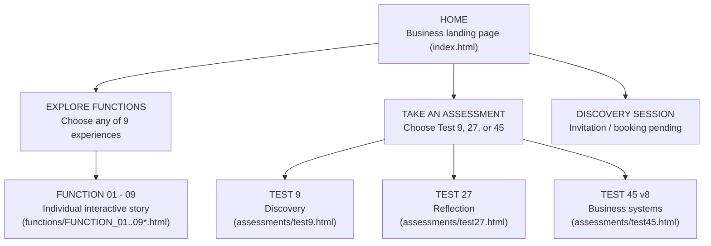

# CORE9 RESOLVE™ — Launch Checklist & Open Items

## Content & Approval Gates
- [ ] **Function 2 (`functions/FUNCTION_02_INTERACTIVE_REVIEW.html`)**: Confirm final author approval (currently in review files).
- [ ] **Function 5 (`functions/FUNCTION_05_INTERACTIVE_REVIEW.html`)**: Confirm final author approval (marked *IN DEVELOPMENT* in `content/functions/APPROVAL_REGISTER_2026-11-07.md`).
- [ ] **Assessments (`assessments/`)**:
  - Confirm author approval of automated interpretation text for Test 27 and scoring/prioritization rules for Test 45 (`v8`).
  - Verify EN/RU switching, copy/export, back/edit navigation, and mobile rendering in real browsers.
- [ ] **Our Team (`index.html#team-note`)**: Add approved biographies and portrait assets.

## Missing External URLs & Assets
- [ ] **Consultation Booking URL**: Connect real booking link to `Book a Discovery Session` (`index.html`) and `Talk to a CORE9 Expert` (`shows.html`).
- [ ] **Circle of Nine Visual**: Locate/integrate approved Circle of Nine graphic and interaction contract to replace the temporary grid in `index.html` / `functions.html`.
- [ ] **Watch & Learn (`watch-and-learn.html`)**: Supply Vasili & Svetlana YouTube playlist embed URL.
- [ ] **Calendar (`calendar.html`)**:
  - Supply Calendar introduction YouTube video URL.
  - Connect completed English Calendar PDFs (1–9), pricing, checkout URLs, and family-bundle rules.
- [ ] **Audio Shows (`shows.html` + `docs/podcast-handoff/`)**:
  - Select podcast host, generate separate RSS feeds for *Business Unusual* and *Mr. Right & Mrs. Maybe*, and produce pilot episodes.
  - Build individual show archive and episode detail pages (`/shows/business-unusual/`, `/shows/mr-right-mrs-maybe/`) with accessible audio player and transcripts.
  - Connect newsletter signup and verified podcast directory links.
- [ ] **Legal & Contact**: Add public contact details, Privacy Policy, and Terms pages.

## Pre-Launch Technical QA
- [ ] Add shared site navigation wrapper (or move into a static site generator / framework) for `functions/FUNCTION_01..09` and `assessments/test*.html` once approved for integration edits.
- [ ] Remove `<meta name="robots" content="noindex,nofollow">` and staging notices across all public pages when ready to go live.
- [ ] Run desktop & mobile cross-browser QA, accessibility audit, and link validation (including results/personalized reports per answer pattern, automatic next-page behavior, and booking destination).

## Site Flow Reference (from Staging Navigation Overview PDF)
*Source: 5-page `CORE9 RESOLVE | Staging navigation overview | Not browser-validated` PDF (captures the core staging ZIP flow prior to adding `functions.html`, `assessments/index.html`, `shows.html`, `watch-and-learn.html`, and `calendar.html`).*

### Reference Notes from PDF
- **Homepage scrolling structure (`index.html`):** 1. Hero → 2. Recognition → 3. Approach *(followed in current `index.html` by `04 / The Pathway`)* → 4. Nine functions → 5. Assessments → 6. Invitation (*Book a Discovery Session*, destination not verified) *(plus `Our Team` placeholder and expanded top/footer nav in current build)*.
- **Nine Interactive Function Pages (`functions/`):** Each function (`01`–`09`) opens as a separate preserved HTML experience.
- **Three Assessment Entry Pages (`assessments/`):** `test9.html` (Discovery), `test27.html` (Personal reflection), `test45.html` (Business assessment v8) — each has English entry + Russian source files.
- **Unconfirmed items flagged in diagram PDF:** Question progression and back/next controls, final personalized report for each answer pattern, automatic next-page behavior, language switching and mobile presentation, and consultation link / actual booking destination (browser screenshots and live click-through were not yet validated).

